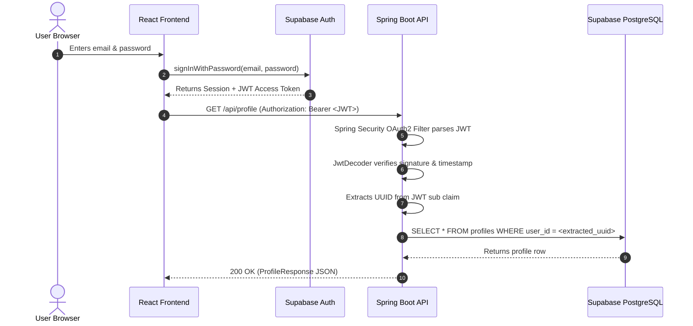

# CareerPilot AI — Phase 1: Database & Authentication Specification

## 1. Executive Summary

Phase 1 integrates **Supabase Auth** and **Supabase PostgreSQL** into the CareerPilot AI platform. The implementation establishes:

- **Frontend Authentication**: User registration, login, logout, password recovery, session persistence, and protected routes using the official `@supabase/supabase-js` SDK.
- **Backend JWT Verification**: Spring Security 6 OAuth2 Resource Server filter chain validating Supabase JWT signatures, expiration, and issuer claims.
- **Version-Controlled Database Migrations**: Flyway migrations defining `profiles`, `skills`, `user_skills`, `jobs`, and `applications` tables with constraints, indexes, and Row Level Security (RLS) policies.
- **Strict User Ownership Enforcement**: Business endpoints (`GET /api/me`, `GET /api/profile`, `PUT /api/profile`) derive user identity strictly from the verified JWT `sub` claim.

---

## 2. Supabase Project Setup Guide

Follow these manual configuration steps in your Supabase dashboard:

### 2.1 Project Creation & Keys
1. Log in to [supabase.com](https://supabase.com) and create a new project (e.g., `careerpilot-prod` or `careerpilot-dev`).
2. Navigate to **Project Settings** > **API**:
   - Copy **Project URL** &rarr; `VITE_SUPABASE_URL`
   - Copy **Project API keys: `anon` / `public`** &rarr; `VITE_SUPABASE_ANON_KEY`
   - Under **JWT Settings**, copy **JWT Secret** &rarr; `SUPABASE_JWT_SECRET` (minimum 32-character HMAC secret)
   - Alternatively, note the JWKS URL (`https://<project-ref>.supabase.co/auth/v1/.well-known/jwks.json`) if using asymmetric signing (`RS256`/`ES256`).

> [!WARNING]
> **Never** expose the `service_role` secret or database password to the frontend or check them into version control.

### 2.2 Auth Providers & Email Settings
1. Navigate to **Authentication** > **Providers** > **Email**:
   - Ensure **Enable Email provider** is turned **ON**.
   - Ensure **Confirm email** is configured according to your environment (recommended ON for production, can be toggled OFF for rapid local testing).
2. Navigate to **Authentication** > **URL Configuration**:
   - **Site URL**: `http://localhost:5173`
   - **Redirect URLs**: Add:
     - `http://localhost:5173/**`
     - `http://localhost:5173/reset-password`

---

## 3. Environment Variables Reference

### Frontend (`frontend/.env`)
```bash
# Backend Spring Boot API base
VITE_API_BASE_URL=http://localhost:8080/api

# Public Supabase Client Config (Safe for browser)
VITE_SUPABASE_URL=https://<your-project-ref>.supabase.co
VITE_SUPABASE_ANON_KEY=<your-supabase-public-anon-key>
```

### Backend (`backend/.env`)
```bash
SERVER_PORT=8080
SPRING_PROFILES_ACTIVE=dev

# Supabase PostgreSQL Connection
# Obtain from Project Settings > Database > Connection string (JDBC)
SUPABASE_DB_URL=jdbc:postgresql://<db.your-project-ref.supabase.co>:5432/postgres?sslmode=require
SUPABASE_DB_USERNAME=postgres
SUPABASE_DB_PASSWORD=<your-database-password>

# Enable Flyway migrations against Supabase PostgreSQL
FLYWAY_ENABLED=true

# Supabase JWT Signature Verification
# Option A: HMAC-SHA256 Secret (found under Project Settings > API > JWT Secret)
SUPABASE_JWT_SECRET=<your-supabase-jwt-secret-minimum-32-chars>

# Option B: JWKS endpoint for asymmetric keys (RS256/ES256)
# SUPABASE_JWT_JWK_SET_URI=https://<your-project-ref>.supabase.co/auth/v1/.well-known/jwks.json
# SUPABASE_AUTH_ISSUER_URI=https://<your-project-ref>.supabase.co/auth/v1

CORS_ALLOWED_ORIGINS=http://localhost:5173,http://127.0.0.1:5173
```

---

## 4. Database Migrations & Schema Architecture

All migrations are version-controlled in `backend/src/main/resources/db/migration/`:

### 4.1 Schema Tables (`V1__init_careerpilot_schema.sql`)
1. **`profiles`**:
   - `user_id UUID PRIMARY KEY`: Matches Supabase Auth user UUID (`auth.users.id`).
   - `full_name`, `headline`, `location`, `target_role`, `created_at`, `updated_at`.
2. **`skills`**:
   - `id UUID PRIMARY KEY DEFAULT gen_random_uuid()`
   - `name VARCHAR(100) UNIQUE NOT NULL`, `category`, `created_at`.
3. **`user_skills`**:
   - Composite PK `(user_id, skill_id)` with cascading FKs.
   - `proficiency_level` CHECK ('BEGINNER', 'INTERMEDIATE', 'ADVANCED', 'EXPERT').
   - `years_experience INT DEFAULT 0`.
4. **`jobs`**:
   - `id UUID PRIMARY KEY DEFAULT gen_random_uuid()`
   - `title`, `company`, `location`, `description`, `employment_type`, `source_url`.
5. **`applications`**:
   - `id UUID PRIMARY KEY DEFAULT gen_random_uuid()`
   - `user_id` FK to `profiles(user_id)`.
   - `job_id` FK to `jobs(id)`.
   - `status` CHECK ('WISHLIST', 'APPLIED', 'INTERVIEWING', 'OFFER', 'REJECTED', 'WITHDRAWN').
   - Unique constraint `(user_id, job_id)` prevents duplicate applications.

### 4.2 Row Level Security (`V2__enable_rls_policies.sql`)
- Enables RLS across all tables.
- Protects client queries executed through Supabase PostgREST by validating `auth.uid() = user_id`.
- Allows authenticated users to view global `skills` and `jobs` catalogs.
- Provides defense-in-depth if direct Supabase browser SDK queries are used in future phases.

### 4.3 Development Seed Data (`db/seed/dev_seed.sql`)
- Contains sample skills (Java, Spring Boot, React, TypeScript, Docker, etc.) and industry jobs.
- **Isolated from migrations**: Not executed automatically in production environments.

---

## 5. Spring Boot JWT Verification Mechanism



1. **Stateless Filter Chain**:
   - Configured in `SecurityConfig.java`.
   - Public: `/api/health` and CORS `OPTIONS` pre-flight requests.
   - Protected: All other `/api/**` routes require a valid JWT token.
2. **Error Standardization**:
   - Missing or invalid token &rarr; `401 Unauthorized` with `RestAuthenticationEntryPoint`.
   - Unauthorized access &rarr; `403 Forbidden` with `RestAccessDeniedHandler`.
3. **Zero-Trust User Identity**:
   - Endpoints do not accept `userId` from request parameters.
   - `SecurityUtils.getAuthenticatedUserId(jwt)` parses `UUID.fromString(jwt.getSubject())`.

---

## 6. Local Setup and Testing

### 6.1 Running Tests
```bash
# Frontend build & type check
cd frontend && npm run build

# Backend automated test suite
cd ../backend && mvn test
```

### 6.2 Testing Protected Endpoints via cURL
1. Generate or obtain a Supabase access token (via frontend login or Supabase Auth API).
2. Query protected endpoints:
```bash
# 1. Health check (public - no token required)
curl -i http://localhost:8080/api/health

# 2. Get current authenticated user info
curl -i -H "Authorization: Bearer <SUPABASE_JWT>" http://localhost:8080/api/me

# 3. Retrieve profile
curl -i -H "Authorization: Bearer <SUPABASE_JWT>" http://localhost:8080/api/profile

# 4. Create or update profile
curl -i -X PUT \
  -H "Authorization: Bearer <SUPABASE_JWT>" \
  -H "Content-Type: application/json" \
  -d '{"fullName":"Alex Rivera","headline":"Senior Engineer","location":"Remote","targetRole":"Staff Architect"}' \
  http://localhost:8080/api/profile
```

---

## 7. Security Limitations & Phase 2 Outlook

- **Service Connections**: The Spring Boot backend connects via JDBC as an authorized application service. Direct PostgREST queries from browser clients are governed by the RLS policies in `V2`.
- **Secret Management**: For production deployments (AWS, GCP, Render), secrets should be loaded from secret managers (e.g. AWS Secrets Manager, Vault) rather than static `.env` files.
- **Phase 2 Preview**: Skill graph modeling, ATS resume tailoring, and job description gap analysis.
