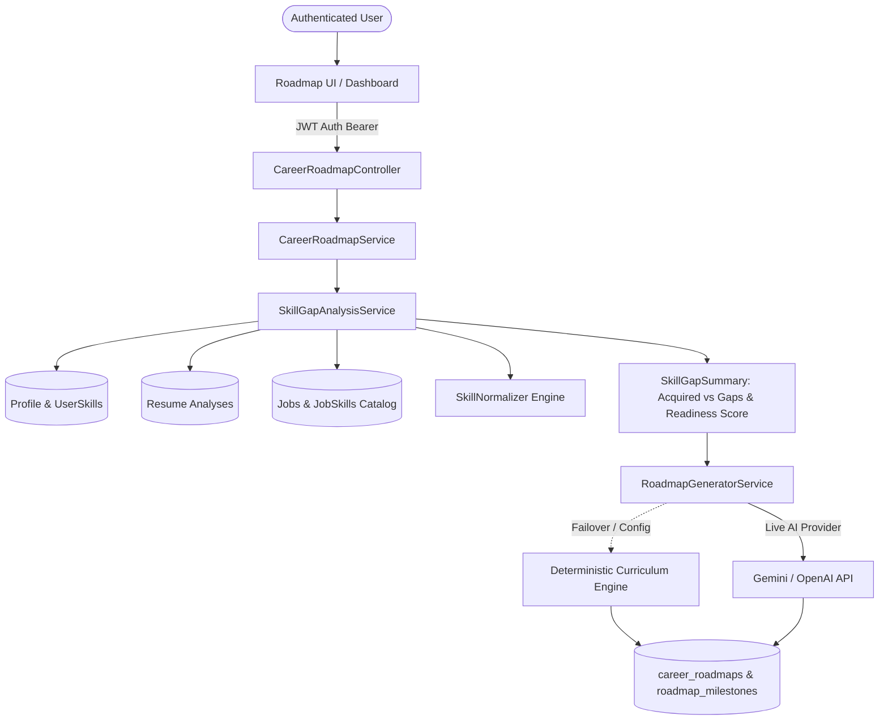

# CareerPilot AI — Phase 5: Personalized Career Roadmap

## 1. Overview

Phase 5 delivers an intelligent, personalized career advancement system that analyzes an engineer's existing competencies (from user profiles and parsed resume analyses), compares them against active market job postings, calculates deterministic skill gaps, and generates a phased, milestone-based learning roadmap.

Engineers can interactively track their progress, mark milestones as in progress or completed, access curated documentation and real-world project deliverables, and take notes along their learning journey.

---

## 2. Architecture & Data Flow

---

## 3. Database Schema & Supabase RLS

Migration file: `backend/src/main/resources/db/migration/V5__phase5_career_roadmaps.sql`

### 3.1 `career_roadmaps` Table
- `id` (UUID, Primary Key)
- `user_id` (UUID, Foreign Key `profiles(user_id) ON DELETE CASCADE`)
- `target_role` (VARCHAR(150), Not Null)
- `current_level` (VARCHAR(50), Default 'Mid-Level')
- `overall_progress` (INTEGER, 0 to 100)
- `status` (VARCHAR(50): `NOT_STARTED`, `IN_PROGRESS`, `COMPLETED`)
- `summary` (TEXT)
- `skill_gap_summary` (JSONB)
- `model_identifier` (VARCHAR(100))
- `created_at` (TIMESTAMPTZ)
- `updated_at` (TIMESTAMPTZ)

### 3.2 `roadmap_milestones` Table
- `id` (UUID, Primary Key)
- `roadmap_id` (UUID, Foreign Key `career_roadmaps(id) ON DELETE CASCADE`)
- `title` (VARCHAR(255), Not Null)
- `description` (TEXT)
- `sequence_order` (INTEGER, Not Null)
- `status` (VARCHAR(50): `NOT_STARTED`, `IN_PROGRESS`, `COMPLETED`)
- `estimated_duration_weeks` (INTEGER, Not Null)
- `completed_at` (TIMESTAMPTZ, Nullable)
- `skills` (JSONB: targeted competencies with priority and rationale)
- `projects` (JSONB: hands-on project deliverables and tech stacks)
- `resources` (JSONB: curated documentation links and learning guides)
- `completion_criteria` (JSONB: observable verification items)
- `notes` (TEXT: personal notes and artifacts)
- `created_at` / `updated_at` (TIMESTAMPTZ)

### 3.3 Row Level Security (RLS)
- Both tables enforce `ROW LEVEL SECURITY`.
- `auth.uid() = user_id` ensures users can only read, insert, update, or delete their own roadmap records.
- Cross-user data isolation is enforced at both the database layer and Spring Security service layer.

---

## 4. Deterministic Skill Gap Analysis Engine

The `SkillGapAnalysisService` calculates exact competency alignments:
1. **Acquired Competencies**: Reads explicit user profile skills and technical evidence extracted from completed resume analyses.
2. **Market Requirements**: Queries active jobs matching the target role from the catalog, aggregating required and preferred skills with demand frequencies.
3. **Gap Categorization**: Segregates missing market competencies into high, medium, and low priority gaps based on requisition frequency.
4. **Readiness Score**: Formulates a 0–100% readiness score based on acquired versus required market competencies.

---

## 5. Roadmap Synthesis: Live AI & Deterministic Fallback

The `RoadmapGeneratorService`:
- Uses live Gemini or OpenAI APIs when configured with a valid API key (`careerpilot.ai.api-key`).
- Generates structured JSON adhering to the milestone schema.
- **Failover / Offline Deterministic Fallback**: In the absence of an API key or on network failure, falls back to a deterministic curriculum engine using verified, official documentation URLs (`spring.io/guides`, `docs.docker.com`, `developer.mozilla.org`, `postgresql.org/docs`, `kubernetes.io/docs`, `docs.aws.amazon.com`, `redis.io/docs`).
- **No Hallucinations**: No invented certifications or non-existent URLs.

---

## 6. REST API Endpoints

All endpoints require verified Supabase JWT Bearer authentication.

| Method | Endpoint | Description |
|---|---|---|
| `POST` | `/api/roadmaps/generate` | Generates a new roadmap for the authenticated user |
| `GET` | `/api/roadmaps` | Lists all historical roadmaps for the user |
| `GET` | `/api/roadmaps/latest` | Retrieves the most recent roadmap with full milestone details |
| `GET` | `/api/roadmaps/{id}` | Retrieves a single roadmap with all milestones |
| `PATCH` | `/api/roadmaps/{id}/milestones/{milestoneId}` | Updates milestone status (`NOT_STARTED`, `IN_PROGRESS`, `COMPLETED`) & notes; recalculates roadmap overall progress |
| `DELETE` | `/api/roadmaps/{id}` | Deletes a roadmap |

---

## 7. Frontend User Experience

Route: `/roadmap` (Component: `RoadmapPage.tsx`)
- **Key Metrics Dashboard**:
  - Overall progress bar with completed milestone counter.
  - Role readiness score gauge.
  - Total market skill ratio (Acquired vs Priority Gaps).
- **Skill Comparison Panel**:
  - Filterable tabs between missing priority gaps and acquired & verified competencies.
  - Priority badges, market demand count, and resume/profile evidence snippets.
- **Interactive Milestone Timeline**:
  - Phased learning journey with status indicators (To Do, In Progress, Completed).
  - Status switcher triggers progress recalculation.
  - Expandable panels with target skills, practical hands-on projects, verified resource links, verification criteria, and interactive personal notes saving.
- **Roadmap Management Controls**:
  - Version switcher for users with multiple generated roadmaps.
  - Plan regeneration modal with target role and seniority tier customization.
  - Delete plan modal with safety confirmation.
